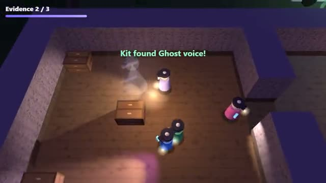

# Ghost Hunt

Find the evidence. Name the ghost. Run. A multiplayer starter game from [Multiplayer Agent](https://multiplayeragent.com): 3D, co-op, 1–4 players, with bot investigators that fill empty seats.

## How it plays

Sneak through a haunted house to find the ghost's cold room, then test it with your EMF meter, thermometer, spirit radio, UV light and ghost book. Three clues name the ghost in your journal. Mark it, and the ghost hunts you all the way to the van.

- Stand in the ghost's room holding a tool to test for that evidence: it shows up, or after a while it's ruled out.
- There are 8 ghost types, each with 3 of the 5 evidences. The journal crosses out the ones that no longer fit.
- Sanity drains inside, faster in the dark and in the ghost's room, and comes back outside. Once the team's sanity is low, the ghost starts hunting: it howls for a moment, then comes for you. Get away from it or get out of the house.
- Score: 100 for the right ghost, 20 per evidence, 25 for everyone who makes it to the van.

**Controls:** WASD to walk, mouse to aim, 1–5 or the tool bar to switch tools, J for the journal, Shift to run, or the touch stick and buttons.

## Make it yours in the Game Builder

Open the [Game Builder](https://multiplayeragent.com), choose **Start from a starter game** and pick Ghost Hunt. It opens as version 1 in your studio, ready to play and publish. Then ask for changes, for example:

- Add a crucifix that stops one hunt
- Make the house bigger with a basement
- Add a ghost that only hunts in the dark

## Run it yourself

1. Get a free publishable key (`pk_…`) at [multiplayeragent.com](https://multiplayeragent.com).
2. In `index.html`, put it in place of `pk_REPLACE_ME` in the `MP_CONNECT` block.
3. Serve the folder (for example `npx serve`) and open it. The 3D engine loads as a module, which browsers block from a file on disk.

Without a key it still runs, offline with bot investigators.

## How it is built

- One `index.html` plus three.js in `libs/`. The comment at the top of the script maps the code and explains the multiplayer.
- **Hidden info:** The ghost type is sealed, never in plain state: only the host's game opens it (each player keeps a sealed copy for when they take over), and everyone sees it at the reveal.
- **Host-run rules:** The host's browser moves the ghost, runs its hunts and decides what evidence your tools find; if it leaves, the next player takes over.
- **Bots:** Bot investigators search the house, test evidence and run from hunts until friends join.
- **Leaderboard:** The best round scores: the right ghost, evidence found and everyone who made it out.
- `?attract` runs it offline with bots only. The preview video is recorded from it.

## License

MIT.
